# OpenHW 1.1.1

[**Download the full OpenHW 1.1.1 installer**](https://openhw.tech/downloads/v1.1.1/OpenHW-Setup.exe) · [Source and release notes](https://github.com/dovahkiinjeff/OpenHW/releases/tag/v1.1.1) · [1.1.1 release notes](docs/RELEASE_NOTES_1.1.1.md)

> [!IMPORTANT]
> **1.1.1 is the full base release. Start here; no 1.1 install or old patch chain is required.** Setup includes the working Launcher, Updater and Diagnostics. Install in a new writable folder using your owned Homeworld Remastered Collection.
>
> **Why 1.1 was retired:** its bundled utilities omitted a required HTTPS support file and could not complete Launcher updates from inside Launcher. The full 1.1.1 package includes those fixes and the completed Diagnostics workflow. 1.1 has been removed from public downloads.
>
> **Existing 1.1 players:** close the game and Launcher, [replace Updater.exe](https://openhw.tech/downloads/v1.1.1/Updater.exe) beside OpenHW.exe and run it once to preserve your installation while moving to 1.1.1. Already on 1.1.1? No reinstall is required.

**The best of both worlds: high-fidelity Homeworld Remastered assets and original Homeworld 1 gameplay.** OpenHW combines RM and HW1 assets with modern rendering and in-game creation tools to build the ultimate classic Homeworld experience.

[**Download OpenHW 1.1.1**](https://openhw.tech/downloads/v1.1.1/OpenHW-Setup.exe) · [Source and release notes](https://github.com/dovahkiinjeff/OpenHW/releases/tag/v1.1.1) · [Complete 1.1.1 source](https://github.com/dovahkiinjeff/OpenHW/releases/download/v1.1.1/OpenHW-1.1.1-Source.zip) · [Release notes](docs/RELEASE_NOTES_1.1.1.md) · [Installation and controls](docs/USER_GUIDE.md) · [Editors](docs/EDITING_GUIDE.md) · [Modding](docs/MODDING.md) · [Build the installer](BUILD_INSTALLER.md)

**The full 1.1.1 installer requires a fresh installation in a separate folder. Do not apply the old 1.0 patch chain to it.** Put OpenHW-Setup.exe in the new folder, select your owned Homeworld Remastered Collection, and let setup build the game there. Your old installation, saves and settings are not overwritten. Launcher.exe and Updater.exe are included.

> [!IMPORTANT]
> **Use AMD technology for 1.1. AMD FSR upscaling and AMD FSR frame generation are the recommended, working options.** DLSS currently has known visual issues and is not recommended. Intel upscaling is also not recommended. **NVIDIA and Intel frame generation are not implemented for this release.** Bundled vendor libraries or development code do not imply supported release features.

> **OpenHW 1.1.1 release:** Shift+F11/F12 live map, lighting and texture authoring menus are disabled in both game executables. Authored environments still load normally. The reference below describes the developer tools; source builds can explicitly enable them with `-DHW_ENABLE_LIVE_MAP_AUTHORING=ON`. The ship and parade editors are separate tools.

**Publication:** compiled downloads are hosted on openhw.tech. GitHub hosts source code and release notes; its update feed is a metadata fallback only.

## OpenHW 1.1.1 - dedicated multiplayer and a new installation pipeline

Create and join online matches through the OpenHW server. The match host selects the map, teams, AI players and shared gameplay rules. The server runs the authoritative simulation and AI; players connect to it over HTTPS. Direct piloting, EVE-style Command control, formation spread and individual ship appearance remain integrated with the multiplayer command path. See [multiplayer setup, controls and current limits](docs/MULTIPLAYER_PREVIEW.md).

**Diagnostics** in the main menu opens a report window. Select a saved diagnostics name or create one using your Homeworld/modding-community alias, add a comment, and choose **Save name + comment**. Saving creates a persistent private folder on the server. **Upload all new logs** sends every previously unuploaded log and crash dump in Development/Logs, in bounded batches. Successful uploads are remembered locally; changed logs are eligible again and failed batches can be retried. The save name identifies your diagnostics folder, not a campaign save. Nothing uploads during normal play. Logs can contain local file paths. The same window is available under the launcher's Ship Systems page.

The installer reads selected files from your owned Collection archives and builds the runtime locally. The 1.1 pipeline releases disposable conversion files as they are packed, avoiding a second complete loose copy beside the final game archive. See [installation disk-space details](BUILD_INSTALLER.md); the full-install peak varies with the selected source and has not been measured end to end for every configuration.

This release also includes the community corrections to salvage delivery and Khar-Selim attachment points, tutorial progression, Sensor Manager menu transitions, HUD visibility, research descriptions, starting resource fleets, battle chatter and native navigation-light/engine attachment positions. [Full 1.1 notes](docs/RELEASE_NOTES_1.1.md).

## Automatic updates

The launcher and [**Updater.exe**](https://github.com/dovahkiinjeff/OpenHW/releases/download/v1.1/Updater.exe) prefer **openhw.tech** for the update feed and downloads, with **GitHub as a fallback**. Downloads are checked against published SHA-256 hashes before installation. Close the game before installing updates. Files, backups and logs stay in the OpenHW folder under Development.

**Already have the old updater?** Run it in your existing installation. Its GitHub feed supplies the new updater automatically. The new updater explains the separate fresh-install requirement for 1.1 and links to its download; it does not overwrite a 1.0 installation. After installing 1.1, use the included launcher/updater for subsequent updates. Manual downloads remain available on GitHub. [Updater documentation](docs/UPDATER.md).

## Previous 1.0 releases

The following section and feature tour document the previous release. Their old patch prerequisites apply only to the historical 1.0 line; new 1.1 installations use the full installer above.

## 1.0.7 - Fleet Command launcher, new menus and community fixes

[**Download OpenHW-Patch-1.0.7.exe**](https://github.com/dovahkiinjeff/OpenHW/releases/download/v1.0.7/OpenHW-Patch-1.0.7.exe) (about 49.5 MB) - [Release notes](RELEASE_NOTES_1.0.7.md) - [Complete cumulative source](https://github.com/dovahkiinjeff/OpenHW/releases/download/v1.0.7/OpenHW-1.0.7-Source.zip) - [Standalone Updater](https://github.com/dovahkiinjeff/OpenHW/releases/download/v1.0.7/Updater.exe).

**The 1.0.7 patch installs Launcher.exe automatically beside OpenHW.exe. Requires the base game and all patches through 1.0.6.** Close both game executables and the launcher before patching. Updater.exe installs the full required patch chain and refreshes itself before 1.0.7. Saves, settings, mods and authored missions are kept.

The new portable launcher manages play, diagnostics, searchable game settings, updates, shader-cache rebuilding, mod activation/load order and owned voice-pack import. In-game changes include redesigned Story/Multiplayer/Modding menus, a live interceptor paint/trail viewer, working single-ship colour controls, keyboard layouts and language selection, optional larger starting resource fleets, Sensors/Build input fixes, carrier-building AI and native ship attachment/material corrections. Read the full notes for scope and validation.

### See the features

The supplied development screenshots illustrate new tools and existing capabilities retained by 1.0.7. Some show 1.0.6; captions identify pre-fix orientation/input views, white-model editor references and the duplicate. [Separate illustrated guide](docs/FEATURE_TOUR_1.0.7.md).

Open the complete 16-image feature tour

### Portable Fleet Command launcher

**Deploy**

The portable launcher starts normal OpenHW or the full diagnostics executable. The custom border, hangar artwork, bundled fonts and amber/cyan controls carry the game styling into the desktop launcher.

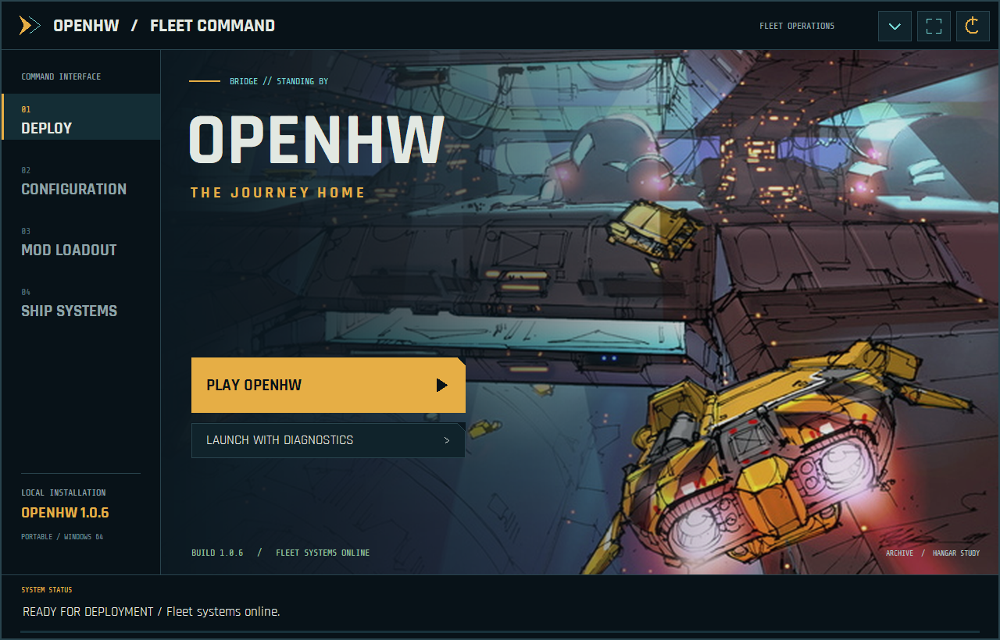

**Mod Loadout**

Enable or disable installed mods and move them up or down in the load order. Later enabled entries take priority; newly discovered mods start disabled. Save the loadout and restart the game to apply changes.

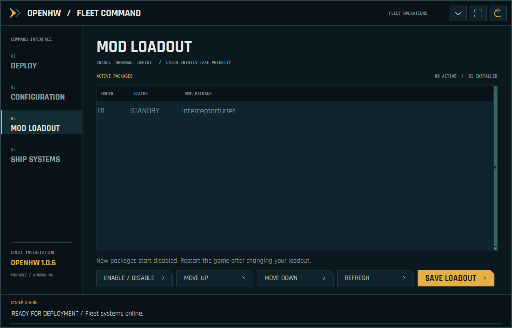

**Configuration**

Browse or search display, graphics, classic effects, audio, keyboard/mouse, player/language, skirmish and gameplay settings. Save them before launching. Shift+F11 authoring documents remain in the in-game editors.

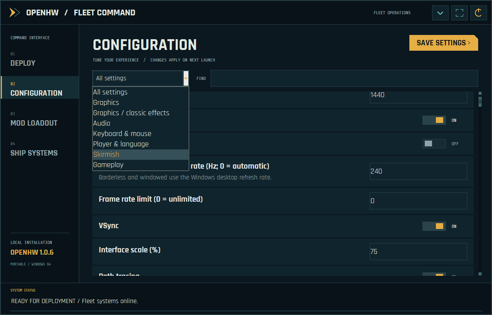

**Ship Systems**

Check for official updates, back up and rebuild the local shader cache, or import a matching voice bank from an owned localized Classic installation. Downloads, runtime files and backups stay in the OpenHW folder.

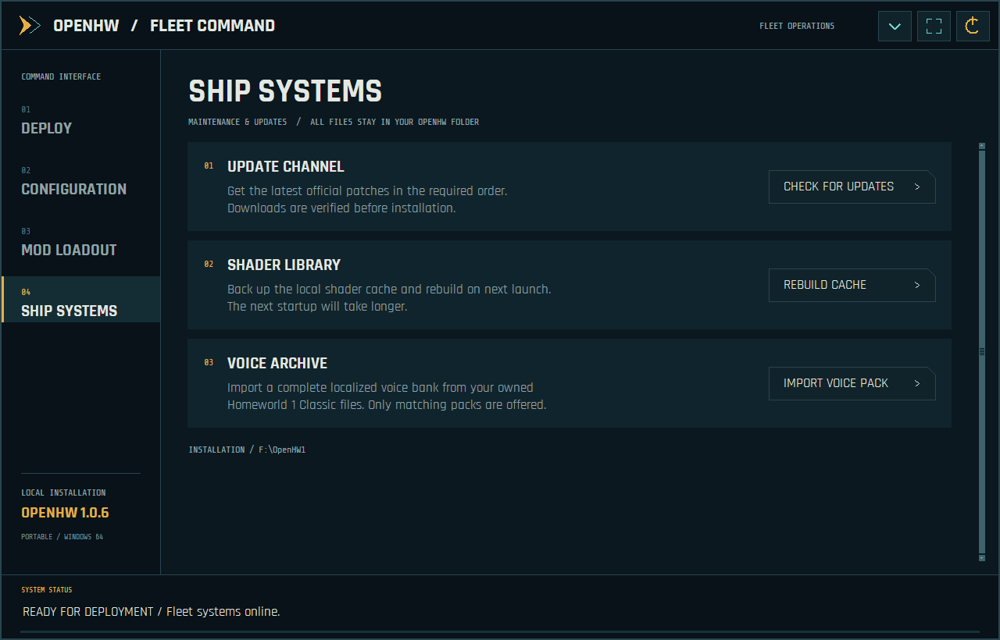

### Menus and live fleet preview

**Main menu**

The fleet command menu groups Story, Training, Multiplayer, Settings, Archive and Modding on the navy overlay while leaving the background artwork visible.

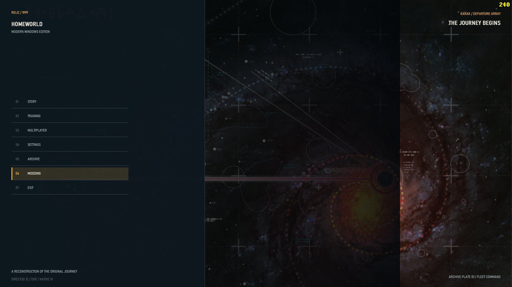

**Story setup and live interceptor**

Centered Story setup combines race selection, saves, Player Setup and a real 3D interceptor. Orbit and zoom the preview; simulate maximum speed to inspect its engine trails. This supplied screenshot predates the 1.0.7 axis correction: the released menu viewer presents the ship horizontally. Gameplay model orientation is unchanged.

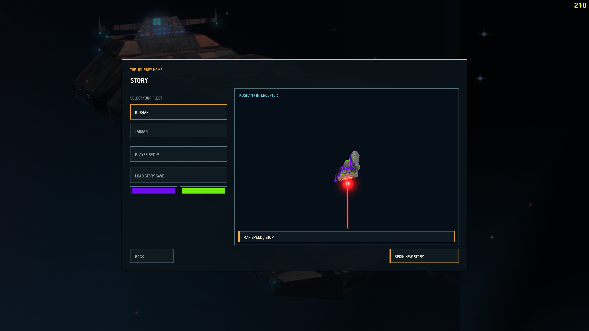

**Multiplayer navigation**

Compact skirmish, saved battle, LAN, online-services and replay actions sit inside the left overlay. Existing connection modes retain their individual availability; this menu redesign does not imply a new online backend or verified multi-computer synchronization.

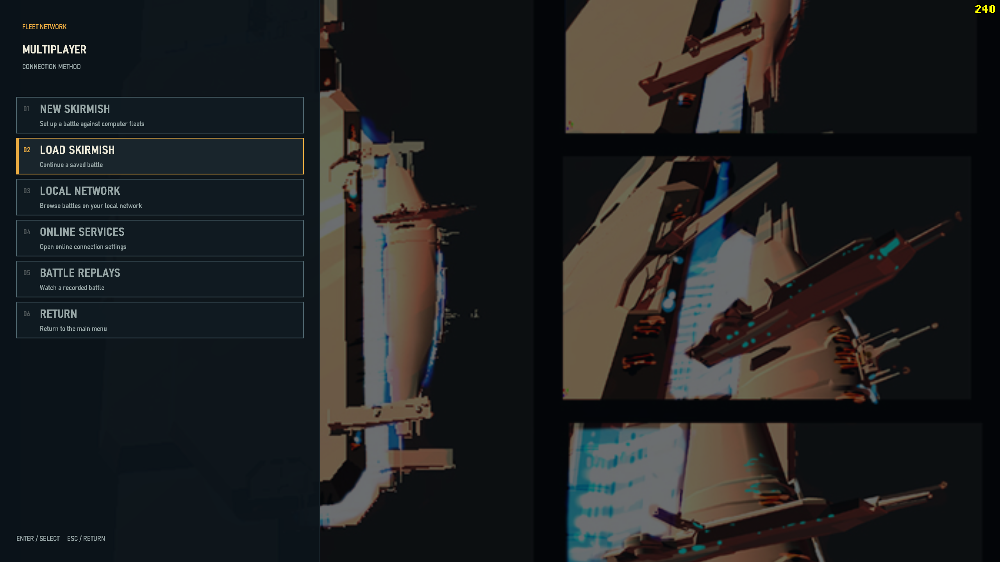

**Fleet Workshop**

The right-hand panel opens Parade Formations, the Ship Editor and Mod Manager without covering the engineering artwork. Use the workshop to arrange fleets, fit subsystems and manage custom content.

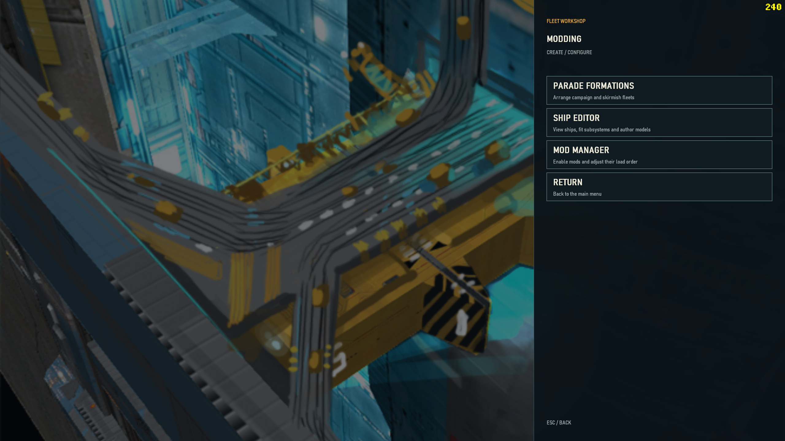

### Authoring tools

**Military Parade editor**

Arrange campaign or multiplayer parade offsets, move/rotate entries, frame the fleet and save separate race/mode presets. This development reference has white model silhouettes; it illustrates the placement interface, not final textured-model appearance.

**Parade editor: supplied duplicate**

This is the second supplied copy of the same parade view, retained as requested. The placed-type list and campaign/MP selector control which formation preset is edited. It is not evidence of a separate feature or a corrected texture-rendering issue.

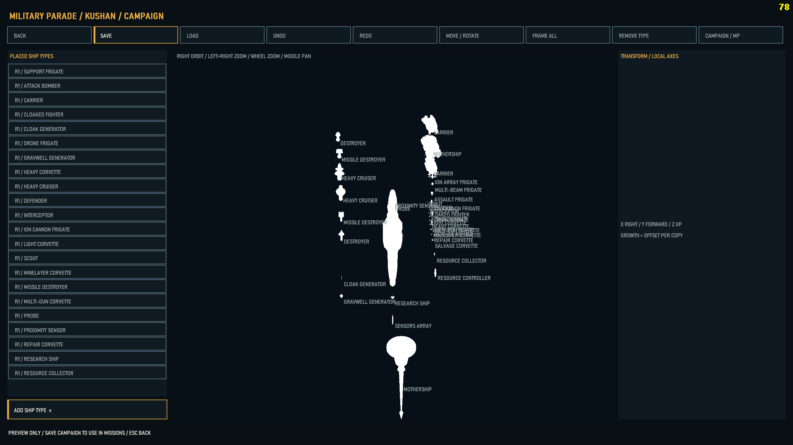

**Ship Editor and subsystem authoring**

Inspect the hull/joint tree, transforms, attachment points and material slots. Copy, paste and place subsystem/turret chains, import geometry and save or append a mod. Source HODs remain read-only. This supplied white-model reference demonstrates the editor layout; this release does not claim to fix those editor silhouettes.

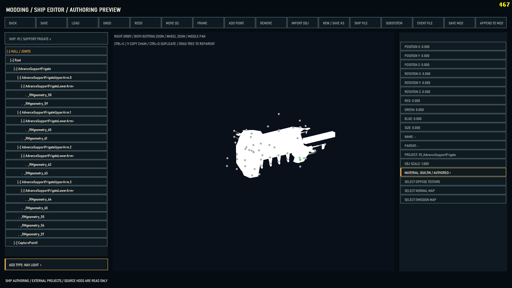

### Campaign, individual colours and ship control

**Fleet command and mission presentation**

Original Homeworld 1 mission scripting and the fleet HUD run with locally imported Remastered ships and authored environments. This view also shows the mission message area and classic-style top-right FPS counter.

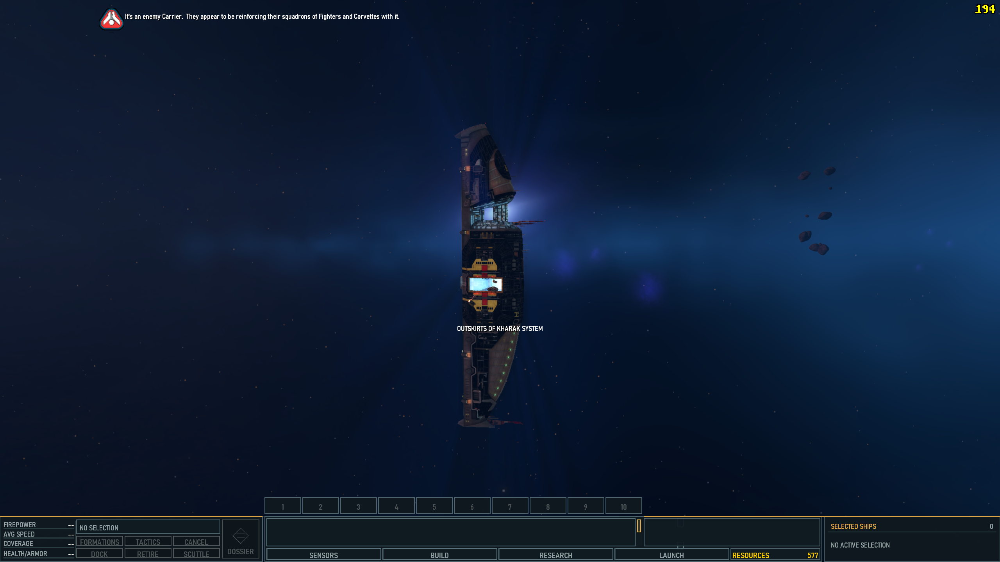

**Remastered ships with original gameplay**

The salvage corvette illustrates the project goal: higher-fidelity imported models while retaining original Homeworld gameplay. The mission HUD, selection information and production shortcuts remain accessible.

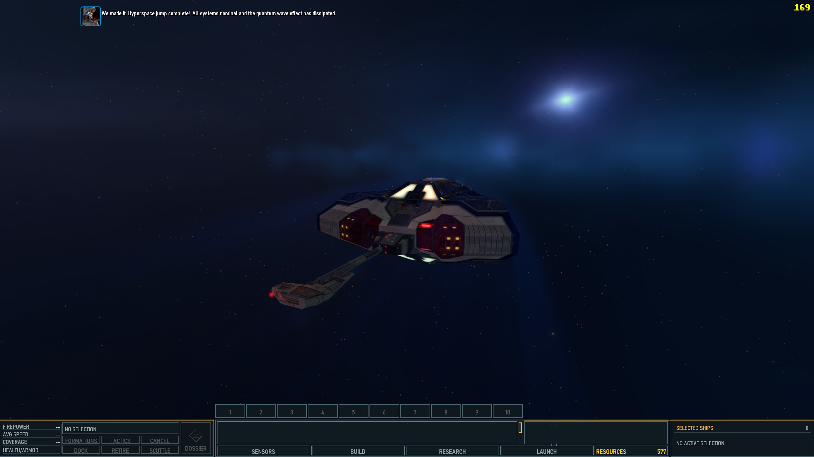

**Single-ship colours**

Select one owned ship and open COLORS beside PILOT. Override hull/base, stripes, engine trails/bulbs, navigation lights, resource beam and hyperspace independently. Unchecked channels inherit fleet appearance; Reset All clears overrides. This screenshot predates the input correction: 1.0.7 fixes the controls, Apply, Reset, Cancel and nested picker routing. Paint is saved for that individual ship. In 1.1 online matches, ship-colour changes use the synchronized server command path.

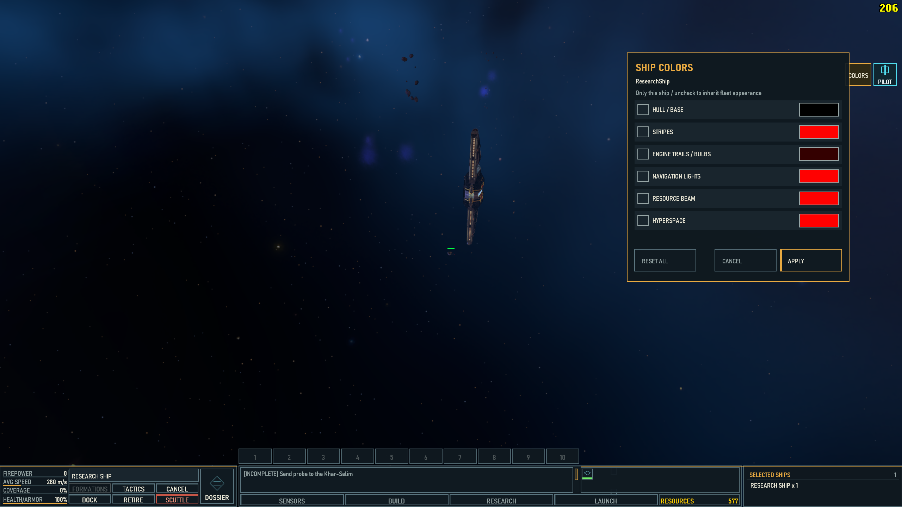

**EVE-style Command control**

Lock targets, approach, orbit, keep range, adjust the speed limit and control weapon banks from one eligible ship. The illustrated command mode is retained alongside direct piloting. Eligible X/Claw formations can also be led through their wingleader.

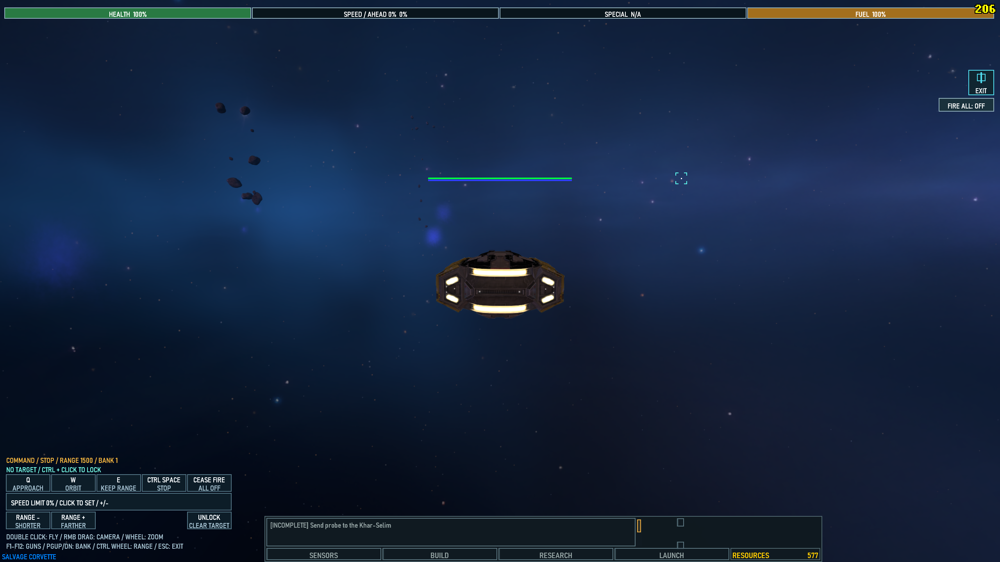

**Direct piloting**

Take direct control of throttle, turning, strafing, vertical movement and weapons. On-screen hints show the available controls; Escape returns to fleet command. Command and Pilot modes are separate choices, with eligibility depending on ship class.

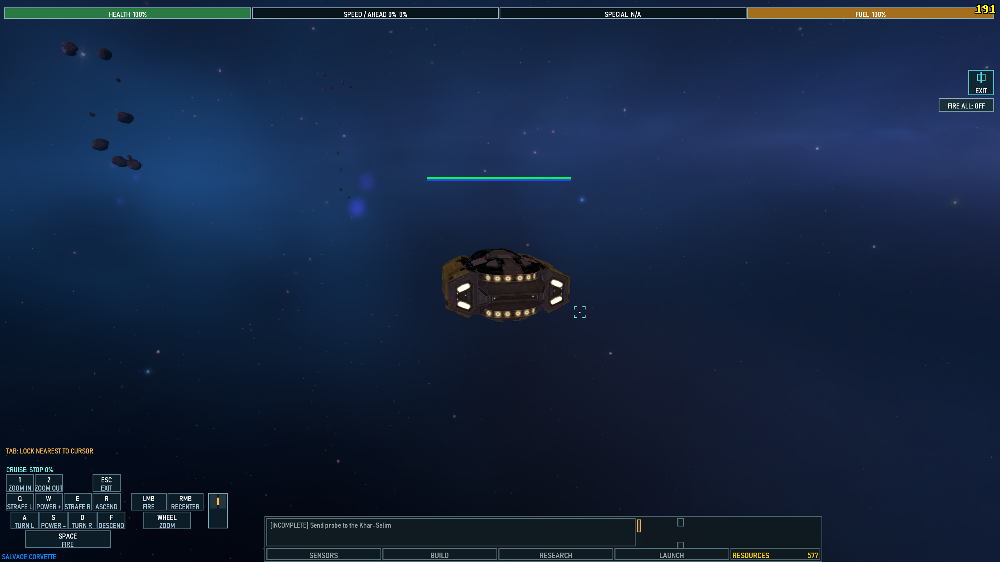

## 1.0.6 patch - texture loading, startup and refresh settings

[Download OpenHW-Patch-1.0.6.exe](https://github.com/dovahkiinjeff/OpenHW/releases/download/v1.0.6/OpenHW-Patch-1.0.6.exe) - approximately **40 MB**. [Patch notes](RELEASE_NOTES_1.0.6.md) - [Complete cumulative source](https://github.com/dovahkiinjeff/OpenHW/releases/download/v1.0.6/OpenHW-1.0.6-Source.zip).

**Requires 1.0.5 first.** Updater.exe automatically installs the required chain. Manual order: base 1.0 -> 1.0.1 -> 1.0.2 -> 1.0.3 -> 1.0.4 -> 1.0.4.5 -> 1.0.5 -> 1.0.6. Close both game executables before patching; saves, settings, mods and authored maps are preserved.

- Improves repeated texture preparation identified in community GTX 1080 Ti logs. A bounded immutable cache avoids repeated decompression while preserving independent writable buffers, mod reloads and the existing memory limit. An isolated developer-machine test improved from 185 ms to 28 ms for 32 requests; **this is not a verified 1080 Ti gameplay FPS gain**.
- Fixes a cloud-shader startup failure reproduced on an RTX 5070 Ti. Ordinary and frame-generation variants retain full optimization with compatible flow control and separate cache identities. Tested cloud output remains identical.
- Keeps an exclusive-fullscreen refresh request such as 360 Hz from being overwritten by a 60 Hz desktop mode. Video options show active timing separately. **Borderless/windowed refresh is controlled by Windows**; the saved exclusive refresh applies after restarting in exclusive fullscreen.

Further GPU performance on older hardware still needs same-scene player testing. These fixes retain texture detail, cloud quality, lighting and simulation behavior. [Technical evidence and scope](docs/PERFORMANCE_PASS_2026_11_12.md).

## 1.0.5 patch — performance update

[Download OpenHW-Patch-1.0.5.exe](https://github.com/dovahkiinjeff/OpenHW/releases/download/v1.0.5/OpenHW-Patch-1.0.5.exe) · [Patch notes](RELEASE_NOTES_1.0.5.md) · [Complete cumulative source](https://github.com/dovahkiinjeff/OpenHW/releases/download/v1.0.5/OpenHW-1.0.5-Source.zip)

**Required order: OpenHW 1.0 → 1.0.1 → 1.0.2 → 1.0.3 → 1.0.4 → 1.0.4.5 → 1.0.5.** Close both game executables before patching and install into the same OpenHW folder.

The project owner reports a **200–300% frame-rate increase** in their test. This is an owner-reported result, not a controlled measurement across other systems; gains depend on scene, hardware and settings.

- Faster fleet/LOD lookups and ship-animation preparation, with fewer temporary allocations.
- Fewer redundant rendering commands and faster GPU density reads for converted dust fields.
- Frame generation reuses the completed scene instead of repeating full scene/cloud/effects composition.
- Includes the local test build's cloud-binding repair. Existing resolution, LOD thresholds, cloud sampling, material quality and authored mission settings are retained.
- God rays now use one reduced-resolution pass with depth-aware upsampling, replacing repeated integration in clouds and full-resolution composition. This altered D3D12/HLSL adaptation of [three-good-godrays](https://github.com/Ameobea/three-good-godrays) retains mission-authored shaft color and strength.
- **Graphics → Post Effects → God Ray Quality** adds **Low, Medium (default), High and Ultra**, independent of the God Rays switch and other cloud/lighting controls. All four presets passed offline GPU and settings checks; no additional whole-game FPS gain is claimed for this addition.
- Corrects Mission 2 Khar-Selim salvage contacts to match the Remastered wreck, including contacts and already-clamped salvage corvettes restored from existing saves. Actual HOD joint positions passed offline checks; in-game placement still needs player verification.
- Engine and missile trails enforce scene depth testing so they no longer inherit state that draws them through foreground hulls. Glow appearance and tail transparency are preserved; the correction passed actual D3D12 offscreen checks with frame-generation guides on and off.

The [optional 1080p cutscene pack](https://github.com/dovahkiinjeff/OpenHW/releases/download/v1.0.4.5/OpenHW-Optional-1080p-Cutscenes.zip) remains a separate download. DLSS and Intel work is deferred; AMD FSR upscaling and frame generation remain recommended.

## 1.0.4.5 patch — cinematics, splash and ship control

[Download the patch](https://github.com/dovahkiinjeff/OpenHW/releases/download/v1.0.4.5/OpenHW-Patch-1.0.4.5.exe) · [Release notes and cumulative source](https://github.com/dovahkiinjeff/OpenHW/releases/tag/v1.0.4.5) · [Optional 1080p cutscenes](https://github.com/dovahkiinjeff/OpenHW/releases/download/v1.0.4.5/OpenHW-Optional-1080p-Cutscenes.zip)

Install OpenHW 1.0, then patches 1.0.1, 1.0.2, 1.0.3, 1.0.4 and **1.0.4.5**, in order. The optional 17-video pack is a separate download: extract it into the OpenHW folder with its `Data/Movies/HD` path. Original videos remain available as a fallback.

This patch corrects the startup splash artwork path, removes in-engine cinematic bars, improves first-load cinematic preparation, allows closer ship-editor zoom, and enables EVE-style Command control for corvettes. First-load cinematic and splash changes still need player verification.

## 1.0.4 patch — Super Salvagers and ship detail

[Download OpenHW-Patch-1.0.4.exe](https://github.com/dovahkiinjeff/OpenHW/releases/download/v1.0.4/OpenHW-Patch-1.0.4.exe) — approximately **40 MB**. [Patch notes](RELEASE_NOTES_1.0.4.md) · [Complete cumulative source](https://github.com/dovahkiinjeff/OpenHW/releases/download/v1.0.4/OpenHW-1.0.4-Source.zip).

**Required order: original OpenHW installer → 1.0.1 → 1.0.2 → 1.0.3 → 1.0.4.** Close both game executables before patching and install into the same OpenHW folder.

- Super Salvagers now protects your salvage corvettes against collision and kamikaze-impact damage in single-player.
- The **Mission Resource Scaling** slider blends from vanilla campaign scaling at 0% to all authored starting resources at 100%. Existing saves retain their stored resources.
- Ship and custom asteroid detail levels now follow distance bands, independent of display resolution and field of view.
- The Ghost Ship uses its textured Remastered model at every distance, with a texture fallback for missing color schemes.
- Aligned the Kadeshi fuel pod's engine glow with its Remastered hull.
- Uses the Remastered Khar-Selim wreck's salvage markers and hardens the Bentusi trade image cache. A reported trade crash has not yet been traced without a crash log.

## 1.0.3 patch — docking, selection and effects

[Download OpenHW-Patch-1.0.3.exe](https://github.com/dovahkiinjeff/OpenHW/releases/download/v1.0.3/OpenHW-Patch-1.0.3.exe) — approximately **40 MB**. [Patch notes](RELEASE_NOTES_1.0.3.md) · [Complete cumulative source](https://github.com/dovahkiinjeff/OpenHW/releases/download/v1.0.3/OpenHW-1.0.3-Source.zip).

**Required order: original OpenHW installer → 1.0.1 → 1.0.2 → 1.0.3.** Close both game executables before applying a patch, and install each into the same OpenHW folder.

- Restored the original double-click docking/support action and moved additive selection of visible ships of the same type to **Shift+Ctrl+double-click**.
- Adjusted support-frigate docking positions using Remastered hull markers and repaired missed docking animation cues, including animation state when a ship comes into view.
- Fixed a crash when the build manager was requested again while already open.
- Moved non-capital engine glow and trail origins closer to their hulls, and improved ion-beam impact positioning and sustained effects.

## 1.0.2 patch — skirmish, controls and editing

[Download OpenHW-Patch-1.0.2.exe](https://github.com/dovahkiinjeff/OpenHW/releases/download/v1.0.2/OpenHW-Patch-1.0.2.exe) — approximately **40 MB**. [Complete patch notes](RELEASE_NOTES_1.0.2.md) · [Updated source](https://github.com/dovahkiinjeff/OpenHW/releases/download/v1.0.2/OpenHW-1.0.2-Source.zip).

**Required order: original OpenHW installer → 1.0.1 patch → 1.0.2 patch.** Close both game executables before applying a patch. Install each into the same OpenHW folder; this patch is not a full installer.

- Fixed local AI-skirmish startup with missing loading artwork and redesigned multiplayer setup/submenus, CPU controls and rule sliders.
- Added the detailed story-style loading panel to skirmish/MP, and matching Remastered skies with separate map/lighting overrides.
- Reconnected PILOT, EVE-style COMMAND, cockpit and X/Claw wing-leader controls in skirmish/MP. Network inputs use the ordered command stream; all players must use this rebuilt patch. Multi-computer gameplay still needs player testing.
- Added **Gameplay → Restore Fog of War** for original visibility ranges, with a saved local toggle; defaults OFF.
- Corrected engine-trail origins to match the existing glow bulbs.
- Added the **Derelicts dropdown** and **Objects tab**, independent XYZ/rotation inspector adjustments and per-instance derelict visual scaling.
- Retains authored dust/cloud save-loading and mission-lighting fixes from 1.0.1. Saves, options, mods and authored settings are preserved; backups/logs remain under Development.

## Installation

1. Install your legally owned **Homeworld Remastered Collection**, including Homeworld 1 Classic and the required English archives.
2. Download [**OpenHW-Setup.exe 1.1**](https://openhw.tech/downloads/v1.1/OpenHW-Setup.exe) ([Source and release notes](https://github.com/dovahkiinjeff/OpenHW/releases/tag/v1.1)). Put it in a **new writable folder**, separate from any previous OpenHW installation.
3. Run it and select the Collection installation. The Collection root, HomeworldRM, or its Data directory can be selected; setup also locates Classic data.
4. Let conversion, package building and validation finish. Setup installs **beside itself** and leaves the original Collection untouched. All application files stay in this folder. See [disk budget and conversion details](BUILD_INSTALLER.md#installation-disk-budget).
5. Start **Launcher.exe** or **OpenHW.exe**. Both Launcher.exe and Updater.exe are installed automatically. **No old patches are required for 1.1.** The first launch detects your display resolution and refresh rate. Setup does not start the game automatically.

All application-owned settings, saves, mods, exports and working files stay inside the OpenHW folder. `Development` contains setup work, diagnostics, logs, caches and receipts. Successful setup removes its temporary `SetupSources` and `SetupWork` conversion copies; a failed setup keeps work for recovery. Windows and graphics-driver system caches remain under those components' control.

Two game executables are supplied: **OpenHW.exe** has diagnostic logging compiled out; **OpenHW-Daignostics.exe** enables full diagnostics and writes under **Development**. The spelling of the diagnostic filename is intentional. Source is a separate download for developers, not required to play.

## Microsoft Defender report for 1.0.4

A player reported a Microsoft Defender Bearfoos detection involving the 1.0.4 patch. The released patch and its extracted executables were scanned with Defender on the developer's computer without a detection; Microsoft has not yet confirmed the report as a false positive. The patch is unsigned. Download only from the official release and compare its SHA-256 before deciding how to proceed:

`OpenHW-Patch-1.0.4.exe`: `14edadf7d192380137368fe26cea3e2440f0bb96e9e66047b73551c6bd2c0dff`

In PowerShell, run `Get-FileHash -Algorithm SHA256 -LiteralPath "D:\\Games\\OpenHW\\OpenHW-Patch-1.0.4.exe"`, replacing the path with your downloaded patch's actual location. If the hash differs, do not run it. A matching hash identifies the released file; it does not establish that a detection is a false positive.

If you choose to proceed and Defender blocks the patch, you can add the **specific OpenHW installation folder** as a folder exclusion: open **Windows Security → Virus & threat protection → Manage settings → Add or remove exclusions → Add an exclusion → Folder**, and select your OpenHW folder. Keep the patch in that folder if it is the file being blocked. A folder exclusion reduces protection for all files inside that folder; remove it after use. See [Microsoft's exclusion instructions](https://support.microsoft.com/en-us/windows/security/threat-malware-protection/virus-and-threat-protection-in-the-windows-security-app).

Please report the exact detected filename, threat name, Defender security-intelligence version and file hash, and consider [submitting the flagged file to Microsoft for analysis](https://www.microsoft.com/en-us/wdsi/filesubmission).

## Watch the project

This showcase documents earlier development; use the current installation and patch instructions above.

## Modern rendering and environments

- Native Windows x64 rendering with Direct3D 12 and optional hardware ray/path tracing; a non-path-traced mode is also available.
- Non-path-traced rendering shares authored mission sun/key, ambient and local-light settings, with shadows and emissive materials. **Non-PT Glow Brightness defaults globally to 29%** and adjusts hangar/engine glow textures independently of path-traced rendering.
- AMD FSR reconstruction and frame generation are the recommended 1.0 presentation path. Native rendering remains available. The interface is presented separately from reconstructed scene detail.
- Locally imported Remastered HOD ships, rigs, subsystems, textures, animation/presentation data and distance LODs, including campaign-specific ships and stations. Classic gameplay remains the simulation foundation.
- Fleet colors, mission-specific liveries and captured-ship identity; filtered, mipmapped materials, normal maps, emission and team-color masks.
- Replacement asteroid models/materials, authored LODs, upgraded Classic texture assets, Remastered backgrounds and improved weapon, engine and missile effects.
- OpenMW-derived volumetric cloud rendering adapted to finite, placed map volumes, ropes and detected particle fields. Clouds work without path tracing. Motion is optional and defaults off; there is no swirling requirement.
- Authored cloud color, density, shape and detail control; original dust and rope presentation can be tuned independently. Converted fields follow connected particle distributions instead of requiring a hand-placed volume on every particle.
- Per-mission maps, clouds and lighting shipped as defaults. All 16 map overlays are included, alongside the 15 authored lighting overrides that exist; Mission 15 uses its fallback lighting where no separate override was authored.
- Brightness/gamma, bloom, god rays, lens flare, motion blur, chromatic aberration and film grain; adjustable texture resolution, effect density/budget, PT bounce/sample settings and frame limit; adjustable UI scale and display settings. Internal HDR lighting does not require Windows HDR output.
- More informative startup and mission-loading status, shader/cache work, optimized asset reuse and parallel frame-preparation work. Performance depends on hardware, settings and scene complexity; generated FPS is not simulation FPS.

## Fleet identity, capture and production

The Fleet Identity menu provides hull base/stripe colors, an independent engine-emission color override and player navigation-light appearance controls. Fleet Control includes Capture / Build All, Super Salvagers and Disable Unit Caps options. Capture foreign ships and retain their fleet identity. Captured build-capable ships use their appropriate production rosters. Carrier/mothership production and docking rules account for ship identity, with mission-required exceptions such as the Karos Graveyard communications relay accepting player-controlled fighters and corvettes. Select a build-capable carrier or mothership and press **B** to open its build menu.

## Formations, fleet controls and gameplay

- **Live Formation Spread:** select a same-type group in a formation to adjust its spacing immediately. The center is the normal layout, the left is tight spacing, and the right is twice the default spread. Mixed-type selections do not display this control.
- **Shift+Ctrl+double-click** a ship to add visible ships of that type to the selection. Ordinary double-click retains the original docking and support actions.
- Main-view move placement no longer has the former short-range command clamp; use it like the Sensors Manager within the playable world.
- Revised Launch Manager with improved hold selection, spacing and access to available holds. Drone frigates are excluded from carrier-style hold selection.
- Camera-inside-ship handling hides the obstructing hull instead of drawing the expensive wireframe view.
- Gameplay controls include unlimited strike-craft fuel, orders while paused, weapon recoil, resource multiplier, rank system, mission-start launch behavior, **Unlimited RUs**, **Restore Fog of War**, and **Disable SP Resource Scaling**. The latter retains the full authored single-player resource population instead of reducing it to the campaign's adaptive amount.
- **Show FPS** adds a classic yellow, black-outlined FRAPS-style counter at the top right.
- Redesigned Build, Launch, Research, ship information, menus and loading panels, with subdued background art and scalable text/controls.

## Ship control: command or pilot

Ship control is implemented, primarily for fun and as a foundation for future unusual game modes. Select an eligible ship and use **COMMAND** for EVE Online-style approach, orbit, keep-range, target locking and weapon-bank control, or **PILOT** for direct flight. Direct piloting includes throttle, turning, strafing, vertical movement and firing; eligible fighters also have a cockpit option.

**X and Claw formations can be controlled through their wingleader.** Select the formation's wingleader and enter ship control to lead the wing. The on-screen WINGLEADER status identifies the controlled formation. This is distinct from the Formation Spread slider.

Version 1.0.2 reconnects these controls in local skirmish and adds shared network pilot input. Every network participant must use the same rebuilt patch; full multi-computer play still requires testing.

See the [ship-control reference](docs/USER_GUIDE.md#ship-control) for keys and the differences between command, external pilot and cockpit controls.

## In-game creation and modding

### Maps, clouds, ropes and particle fields

**Shift+F11** opens the live map workspace: Assets, Scene, Volumes, Ropes, RM Dust, Fields, Clouds and Objects. Assets includes a Derelicts dropdown; newly placed objects are listed under Objects, with independent position, rotation and visual-scale controls. Browse assets, place and transform objects, edit existing scene objects, configure cloud volumes, tune rope shapes and work with automatically grouped particle fields. Simulation and mission scripting can be paused independently during authoring.

Cloud color and opacity/density, procedural detail, size, placement and optional motion can be authored. Original dust particles have separate visibility, color and opacity controls; original rope meshes also have color/opacity overrides. Numeric editor fields support direct entry where exposed, including fine particle-spread values. Save/load map overlays and reusable cloud presets without rewriting the retail archives.

### Lighting, shadows and materials

**Shift+F12**, also reachable through the map editor's Lighting button, exposes mission sun/key direction and color, intensity, ambient mode/color, custom lights, tuning and shadows. Place or aim lights, solo the key, adjust visual response, and save/export per-mission authoring. The map editor's texture/material workspace exposes the corresponding live surface controls. Global Non-PT Glow Brightness affects only the non-path-traced renderer.

### Ship editor and reusable subsystems

Open **Modding > Ship Viewer / Editor / New Ship Project**. Preview installed ships, inspect hull/joint and attachment hierarchies, move and rotate parts, copy or duplicate subsystem chains, and edit ship/weapon definitions. Native subsystem edits synchronize to the editable ship definition; copied functional weapon mounts retain their own weapon-slot identities and settings.

**Copy/paste, duplicate and place subsystems—including turrets—on ships**, then save supported configurations as mods. The ship editor will continue improving in future releases.

The workspace includes save/load, undo/redo, numeric transforms, axis handles, a ship-definition text editor and a read-only view of connected event data. OBJ preview/import and image assignment are available for authoring projects; this is not an arbitrary OBJ-to-HOD compiler or a full replacement for external modeling software.

**SAVE MOD** publishes a new native ship mod; **APPEND TO MOD** adds to an existing one. Validation checks native dependencies and bindings. Enable the result in **Mod Manager**, arrange priority, and restart. Modified weapon counts should be tested in a fresh mission: existing saves do not migrate their weapon arrays. The experimental extra-turret Kushan Assault Frigate modification is not enabled or included as a release gameplay override.

### Mod Manager and parade editor

Enable/disable installed mods and drag them into load order. Lower enabled entries override higher ones. Files remain in local `mods` folders; original imported assets remain the baseline. There is no general DLL plugin loader or live simulation-asset hot reload.

The **Military Parade Formation Editor** lets you author Kushan/Taiidan mothership parade layouts using real ship previews, position/rotation handles, numeric edits and growth offsets for repeated ship types. Campaign presets apply to ships joining military parade. Multiplayer-named preset files are editor storage only: multiplayer integration and synchronization are not implemented by that feature.

Read the [editing guide](docs/EDITING_GUIDE.md), [modding guide](docs/MODDING.md), [ship definition format](docs/OPENHW_SHIP_DEFINITIONS.md), and [parade editor guide](docs/MILITARY_PARADE_EDITOR.md).

## Requirements

- Windows 10/11 x64; a writable destination folder.
- Your own installed Homeworld Remastered Collection with the required Classic and English data.
- A supported Direct3D 12 GPU and current graphics driver; hardware DXR capability for path tracing.
**Disk space:** allow approximately **120 GB free during conversion** as a conservative planning estimate; the exact peak of this compact installer has not been measured. The download is about 473 MB and the main generated game archive is about 34 GB, plus loose resources and user data. Setup reads the original Collection archives directly, stages selected HW1 resources and removes intermediate conversion caches. The original Collection and source-build dependencies occupy separate space.
- AMD FSR upscaling/frame generation are the recommended technologies regardless of GPU brand, where supported by the adapter/runtime. Do not select NVIDIA or Intel alternatives expecting 1.0 parity.

## Essential controls

| Control | Action |
| --- | --- |
| Shift+F11 | Live map/cloud editor |
| Shift+F12 | Lighting and shadow editor |
| B with a build-capable ship selected | That ship's build menu |
| Shift+Ctrl+double-click | Add visible ships of the same type to the selection |
| Formation Spread slider | Immediately change same-type formation spacing |
| COMMAND / PILOT | Ship command control / direct piloting |
| Esc during ship control | Return to normal fleet control |
| Modding menu | Ship projects, Mod Manager and parade editor |

## Documentation and source

- [Install, settings and gameplay controls](docs/USER_GUIDE.md)
- [Map, cloud, lighting and texture authoring](docs/EDITING_GUIDE.md)
- [Ship editing, mod publication and load order](docs/MODDING.md)
- [Ship control and formation reference](docs/USER_GUIDE.md#ship-control)
- [Military parade layouts](docs/MILITARY_PARADE_EDITOR.md)
- [Known limitations and reporting](docs/LIMITATIONS.md)
- [1.0.4 patch notes](RELEASE_NOTES_1.0.4.md)
- [1.0.3 patch notes](RELEASE_NOTES_1.0.3.md)
- [1.0.2 patch notes](RELEASE_NOTES_1.0.2.md)
- [1.0.1 patch notes](RELEASE_NOTES_1.0.1.md)
- [1.0 release notes](RELEASE_NOTES_1.0.md)
- [Build OpenHW-Setup.exe from the complete source](BUILD_INSTALLER.md)
- [Third-party notices](THIRD_PARTY_NOTICES.md)

Download **OpenHW-1.0.5-Source.zip** for the full cumulative working source from 1.0 through 1.0.5, including shaders, importers, tools, tests, reviewed release content and installer factory. Generated build caches and your retail data are not part of the source download. The build guide specifies the compiler, SDK and pinned dependencies.

## Immediate future updates

The next priorities are **fully implementing and stabilizing NVIDIA DLSS and Intel technologies**, and **fixing bugs and visual glitches reported by people playing OpenHW**. For 1.0, stick to AMD FSR upscaling and AMD FSR frame generation.

**Cataclysm support remains planned. OpenHW 1.1 introduces server-hosted multiplayer**, which will continue to improve with community testing and performance work. The current service supports one active battle, with no in-battle reconnect, save/resume or host migration. See the [multiplayer guide](docs/MULTIPLAYER_PREVIEW.md) before organizing a match. No delivery date is announced for remaining work.

Player reports matter: they reveal mission, hardware and gameplay combinations that development testing can miss. Please report problems to the project author through [GitHub Issues](https://github.com/dovahkiinjeff/OpenHW/issues), with reproducible steps and useful evidence. The Diagnostics menu uploads all new logs privately into your saved community-alias folder; include that alias and a useful comment when reporting the issue.

## Reporting problems

Include the mission/save context, what you did, expected versus actual behavior, GPU and driver, resolution, path-tracing state, upscaling mode and frame-generation state. Screenshots/video are helpful. Reproduce using `OpenHW-Daignostics.exe` when logs are needed and include the relevant files from `Development`; review captures for personal information before sharing. Do not upload retail archives, extracted game assets, music, voice or movies. See [known limitations](docs/LIMITATIONS.md).

## License and ownership

OpenHW is a free, unofficial project, not affiliated with or endorsed by the original developers/publishers or GPU vendors. The original engine source is subject to the Relic agreement in [LICENSE.txt](LICENSE.txt), including its non-commercial terms. Third-party code and art retain their own notices and ownership; this is not a blanket public-domain or permissive-license release.

The package includes the approved upscaled Classic texture set, supplied concept artwork and creator-made asteroid replacements. Remastered models/materials, retail archives and original audio/movies are imported locally from the user's Collection, not supplied as an installed game download. See [content provenance and build details](BUILD_INSTALLER.md#content-boundary-and-source-snapshot) and [third-party notices](THIRD_PARTY_NOTICES.md).
