# OpenHW 1.0.7 - Fleet Command launcher and community fixes

**Install OpenHW and all patches through 1.0.6 first.** Close OpenHW.exe, OpenHW-Daignostics.exe and Launcher.exe. Put **OpenHW-Patch-1.0.7.exe** in the existing OpenHW folder and run it; if prompted, select that same folder. **The patch installs Launcher.exe beside OpenHW.exe automatically**, including on installations without a launcher. It is not a replacement for the base installer.

Manual order: **1.0 -> 1.0.1 -> 1.0.2 -> 1.0.3 -> 1.0.4 -> 1.0.4.5 -> 1.0.5 -> 1.0.6 -> 1.0.7**. Updater.exe installs the required chain. The updater refresh in this release is 1.0.1 (protocol 2); older updaters obtain it and restart before installing 1.0.7. If refreshing the updater is blocked, download the new Updater.exe beside OpenHW.exe and run it. The base installation and its runtime are required.

Saves, Homeworld.cfg, mods, load order and authored maps/clouds/lighting are preserved. Downloads, logs, runtimes and backups remain under Development. No separate Python install, Windows font install or AppData profile is needed. Allow about **400 MB of additional working space for the patch and backup**, plus up to **150 MB** for the launcher's private runtime on first use; base conversion space is separate.

## Changes

- **Portable Fleet Command launcher:** normal or diagnostics launch, a searchable settings catalogue, official updates, local shader-cache reset, mod activation/load order and owned localized voice-pack import. Includes the custom chrome, concept-art background and bundled fonts.
- **Menu redesign:** compact Multiplayer navigation inside the left panel; Fleet Workshop actions in a matching right panel; centered Story setup with race selection, saves and Player Setup.
- **Live interceptor:** Story/Player Setup use one selected-race 3D interceptor, live hull/stripe paint, orbit/zoom and a maximum-speed trail preview. The viewer now presents it horizontally using a menu-only transform. Preview colour palettes and texture limits do not alter gameplay materials or quality.
- **Individual ship appearance:** COLORS beside PILOT controls six inheritable channels. Apply affects only that ship, Reset All restores inheritance, and Cancel/Escape discard pending edits. Fixes the modal input layer that previously swallowed all clicks. The nested colour picker stays above the panel/HUD. Overrides survive save/load in both game executables and remain a local visual customization.
- **Keyboard and language:** Windows/automatic, US QWERTY, French AZERTY, German QWERTZ, Spanish, Italian and US Dvorak shortcut layouts; classic English/French/German/Spanish/Italian text/subtitles with fallback. Newly written OpenHW labels remain English. Localized voices require an owned matching Classic speech bank and lookup tables; no voice files are downloaded or bundled.
- **Build/Sensors input:** wheel input is captured across the complete docked Build panel; command/formation/tactics menus opened in Sensors remain children of that view, addressing the black screen when closing them.
- **Starting Resource Fleet:** choose mission defaults or top up fresh campaign arrivals to at least three collectors and two controllers. Larger carried fleets remain intact; loading an existing save does not inject ships.
- **Docking and nav lights:** Kushan Support Frigate lights use native HOD joints; captured frigates use a holding point near the mothership's actual frigate hangar. Named docking-point searches are bounded. Existing berth reservations and collision avoidance remain active; no blanket docking-speed multiplier is applied.
- **Skirmish AI:** the economy AI can request a carrier after establishing resource collection when research, caps and reserves allow it; existing queued carriers prevent duplicate requests.
- **Materials and texture lifetime:** private palettes for edited ships, matching classic/RM paint masks and alpha, path-traced surface variants, full-palette fallback and a corrected 64-bit texture-unregister guard.
- Both Windows x64 game builds and the complete cumulative **1.0 through 1.0.7 source** are supplied. OpenHW.exe has diagnostic logging compiled out; OpenHW-Daignostics.exe has full logging under Development.

## Graphics recommendation

**AMD FSR upscaling and FSR frame generation remain recommended.** DLSS has known visual issues; Intel upscaling is not recommended. NVIDIA and Intel frame generation are not implemented. This release does not change those support claims or promise an additional measured FPS gain.

## Checks and remaining verification

The normal/diagnostics x64 builds and offline input, layout, palette, texture lifetime, keyboard, launcher/updater and save-extension checks passed. Packaging checks include an isolated patch install that creates Launcher.exe and frozen runtime self-checks; no automated gameplay or camera manipulation was performed. Busy hangar timing and multi-computer gameplay still need player feedback. The supplied white-model editor references are not a claim of a fixed editor texture issue.

When a future patch replaces Launcher.exe itself, close the launcher and use the standalone Updater.exe. The launcher can install other game updates directly; a replacement of its own running file is refused before game files change.

## Illustrated feature tour

All sixteen supplied images are included below, including the duplicate. They were captured during development and may display 1.0.6. Captions identify the pre-fix viewer/panel and the untextured editor references.

### Portable Fleet Command launcher

**Deploy**

The portable launcher starts normal OpenHW or the full diagnostics executable. The custom border, hangar artwork, bundled fonts and amber/cyan controls carry the game styling into the desktop launcher.

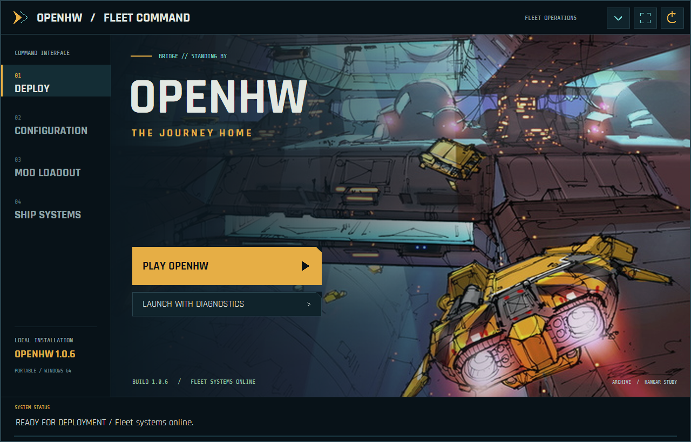

**Mod Loadout**

Enable or disable installed mods and move them up or down in the load order. Later enabled entries take priority; newly discovered mods start disabled. Save the loadout and restart the game to apply changes.

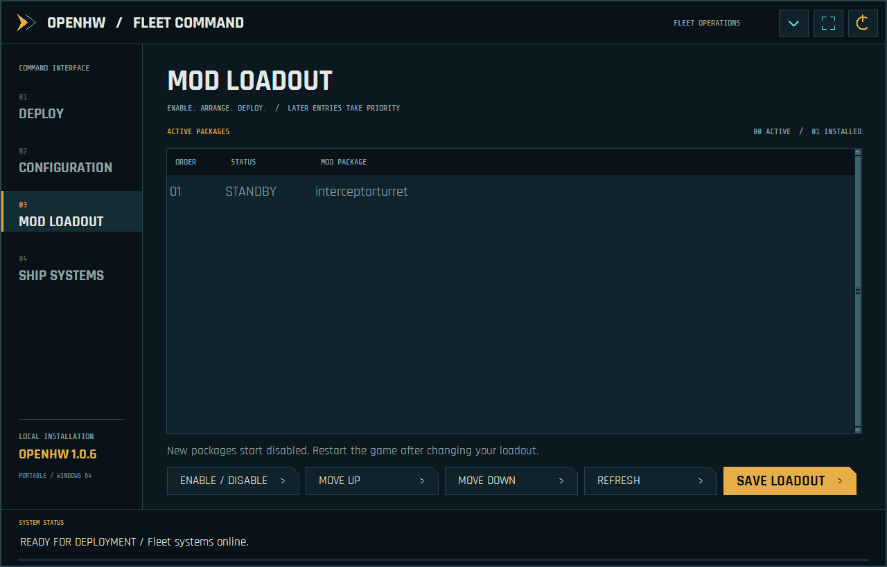

**Configuration**

Browse or search display, graphics, classic effects, audio, keyboard/mouse, player/language, skirmish and gameplay settings. Save them before launching. Shift+F11 authoring documents remain in the in-game editors.

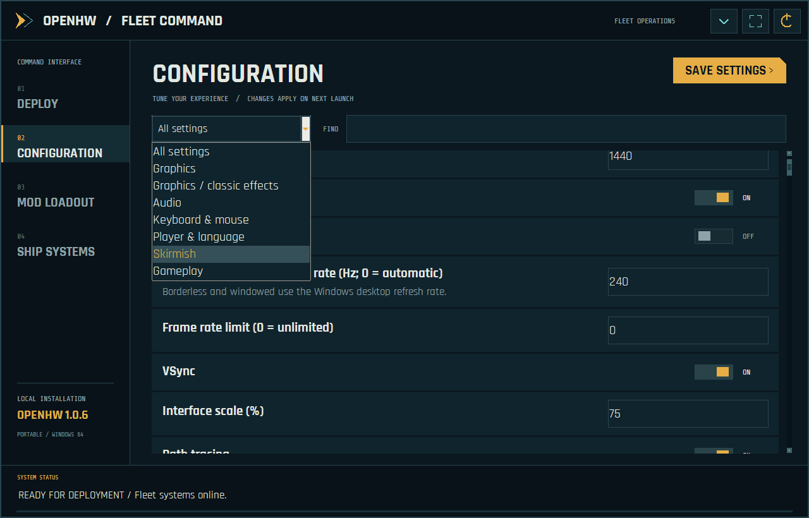

**Ship Systems**

Check for official updates, back up and rebuild the local shader cache, or import a matching voice bank from an owned localized Classic installation. Downloads, runtime files and backups stay in the OpenHW folder.

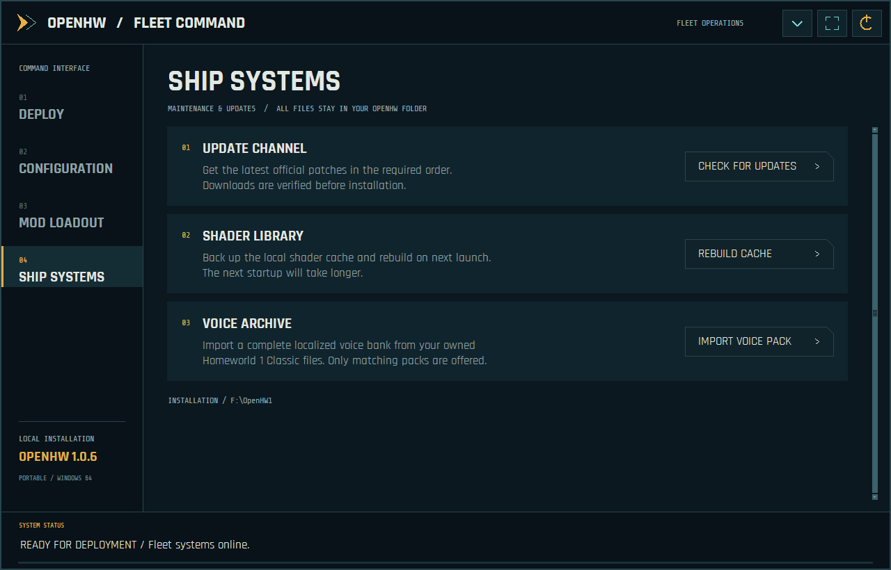

### Menus and live fleet preview

**Main menu**

The fleet command menu groups Story, Training, Multiplayer, Settings, Archive and Modding on the navy overlay while leaving the background artwork visible.

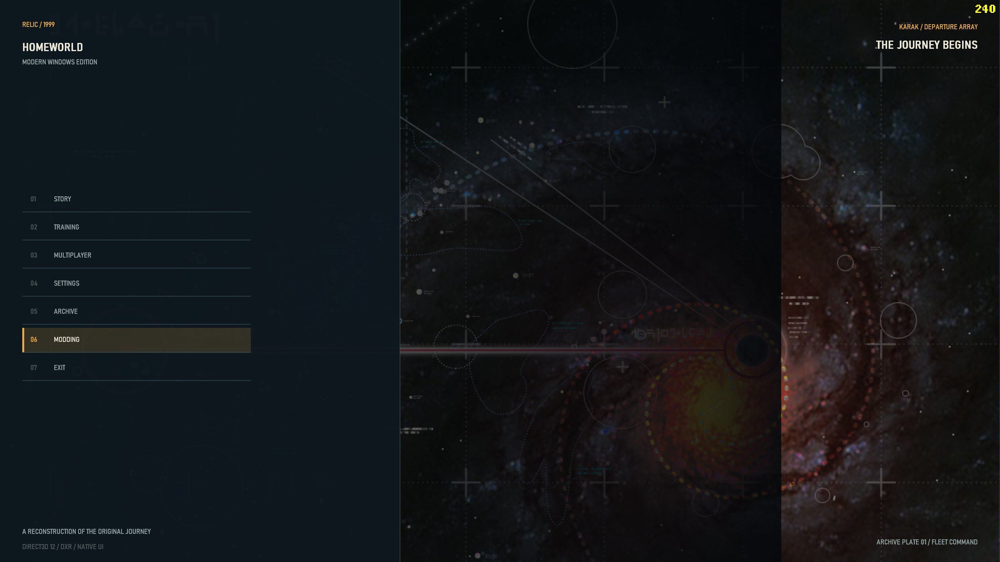

**Story setup and live interceptor**

Centered Story setup combines race selection, saves, Player Setup and a real 3D interceptor. Orbit and zoom the preview; simulate maximum speed to inspect its engine trails. This supplied screenshot predates the 1.0.7 axis correction: the released menu viewer presents the ship horizontally. Gameplay model orientation is unchanged.

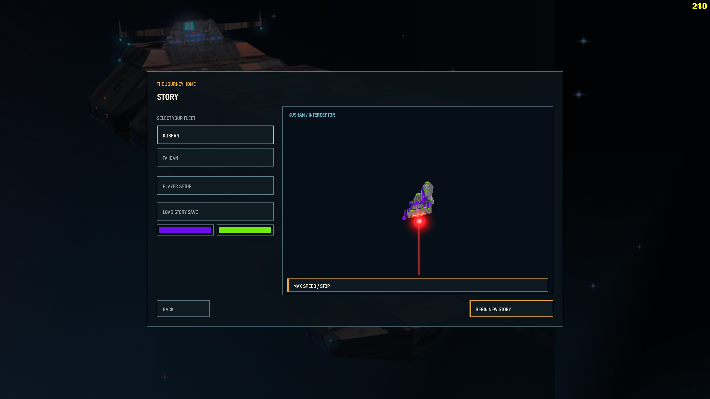

**Multiplayer navigation**

Compact skirmish, saved battle, LAN, online-services and replay actions sit inside the left overlay. Existing connection modes retain their individual availability; this menu redesign does not imply a new online backend or verified multi-computer synchronization.

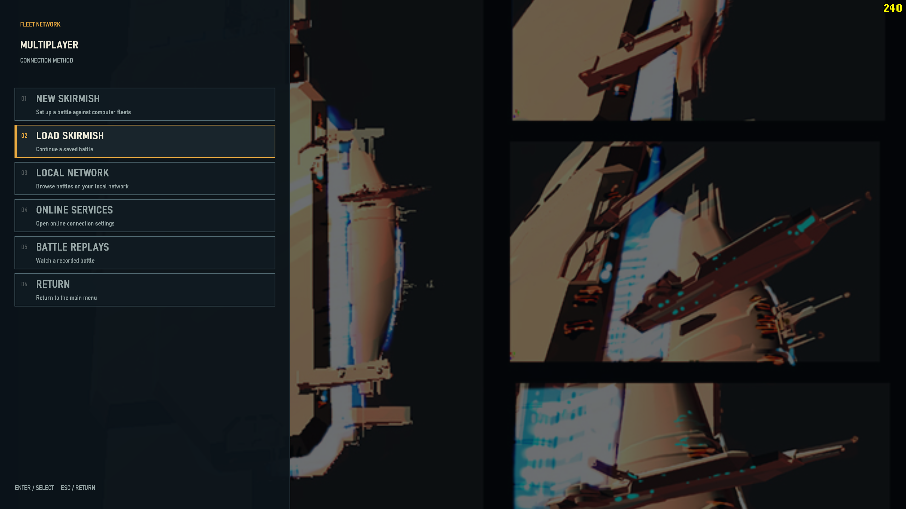

**Fleet Workshop**

The right-hand panel opens Parade Formations, the Ship Editor and Mod Manager without covering the engineering artwork. Use the workshop to arrange fleets, fit subsystems and manage custom content.

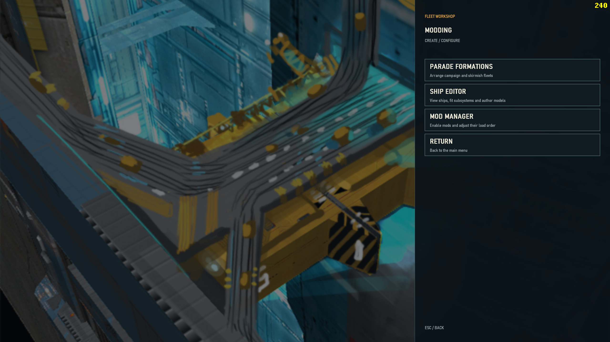

### Authoring tools

**Military Parade editor**

Arrange campaign or multiplayer parade offsets, move/rotate entries, frame the fleet and save separate race/mode presets. This development reference has white model silhouettes; it illustrates the placement interface, not final textured-model appearance.

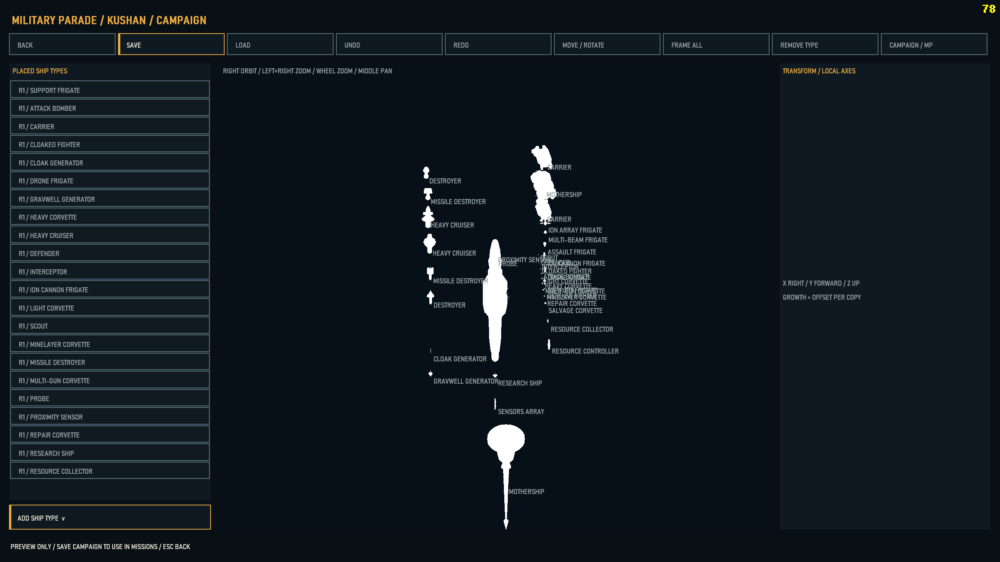

**Parade editor: supplied duplicate**

This is the second supplied copy of the same parade view, retained as requested. The placed-type list and campaign/MP selector control which formation preset is edited. It is not evidence of a separate feature or a corrected texture-rendering issue.

**Ship Editor and subsystem authoring**

Inspect the hull/joint tree, transforms, attachment points and material slots. Copy, paste and place subsystem/turret chains, import geometry and save or append a mod. Source HODs remain read-only. This supplied white-model reference demonstrates the editor layout; this release does not claim to fix those editor silhouettes.

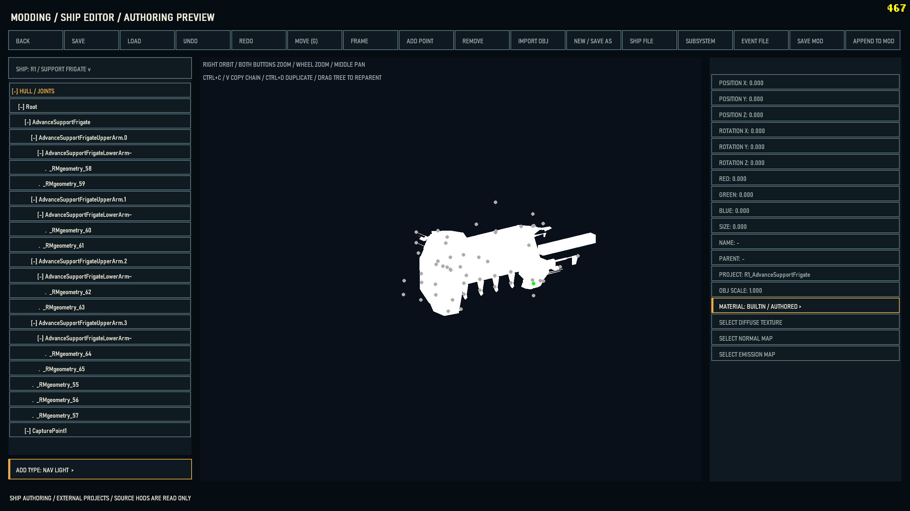

### Campaign, individual colours and ship control

**Fleet command and mission presentation**

Original Homeworld 1 mission scripting and the fleet HUD run with locally imported Remastered ships and authored environments. This view also shows the mission message area and classic-style top-right FPS counter.

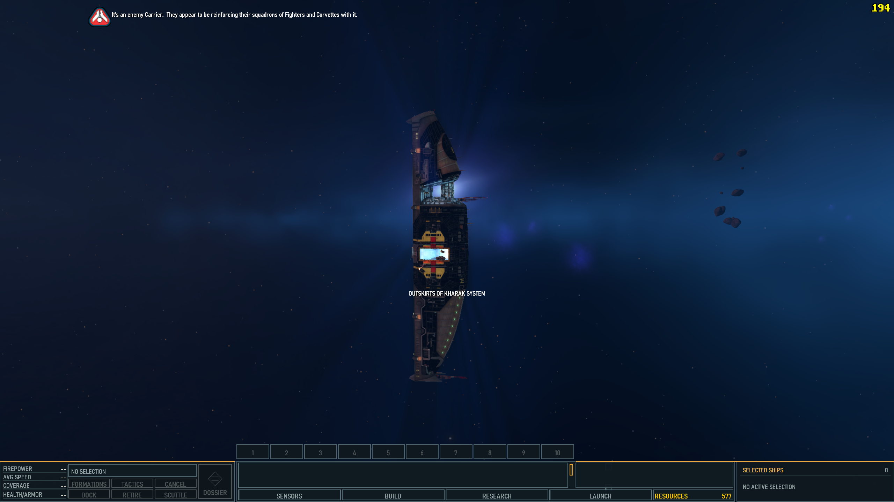

**Remastered ships with original gameplay**

The salvage corvette illustrates the project goal: higher-fidelity imported models while retaining original Homeworld gameplay. The mission HUD, selection information and production shortcuts remain accessible.

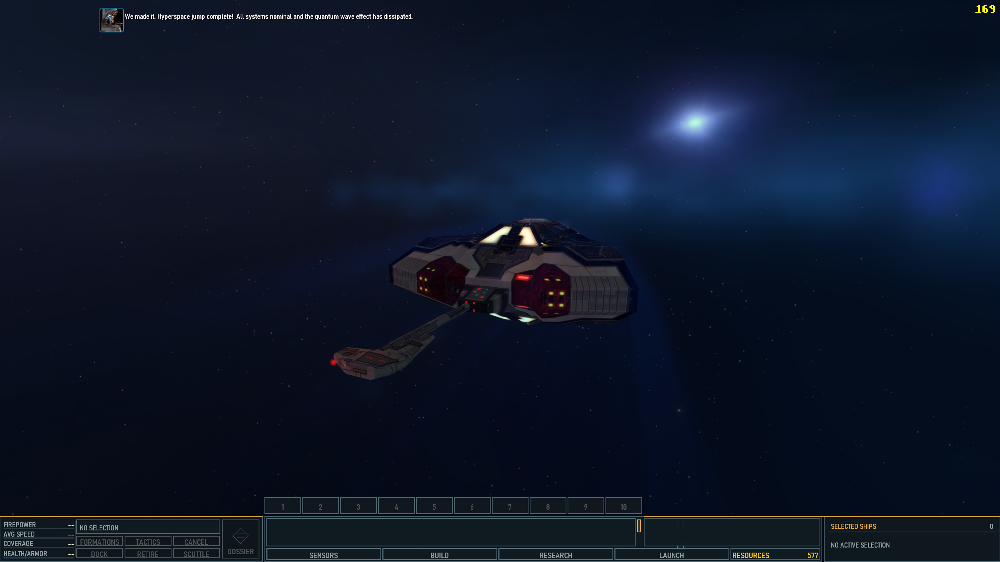

**Single-ship colours**

Select one owned ship and open COLORS beside PILOT. Override hull/base, stripes, engine trails/bulbs, navigation lights, resource beam and hyperspace independently. Unchecked channels inherit fleet appearance; Reset All clears overrides. This screenshot predates the input correction: 1.0.7 fixes the controls, Apply, Reset, Cancel and nested picker routing. Paint is saved for that individual ship; it is a local visual customization, not a new synchronized multiplayer command.

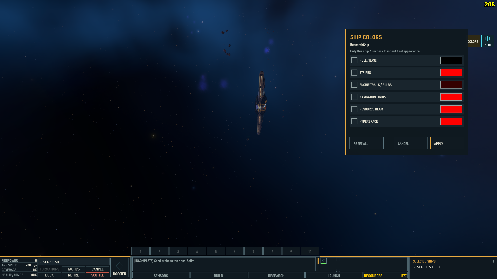

**EVE-style Command control**

Lock targets, approach, orbit, keep range, adjust the speed limit and control weapon banks from one eligible ship. The illustrated command mode is retained alongside direct piloting. Eligible X/Claw formations can also be led through their wingleader.

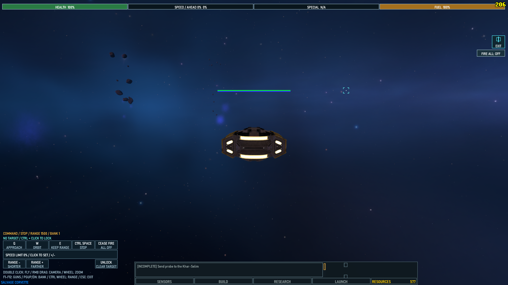

**Direct piloting**

Take direct control of throttle, turning, strafing, vertical movement and weapons. On-screen hints show the available controls; Escape returns to fleet command. Command and Pilot modes are separate choices, with eligibility depending on ship class.

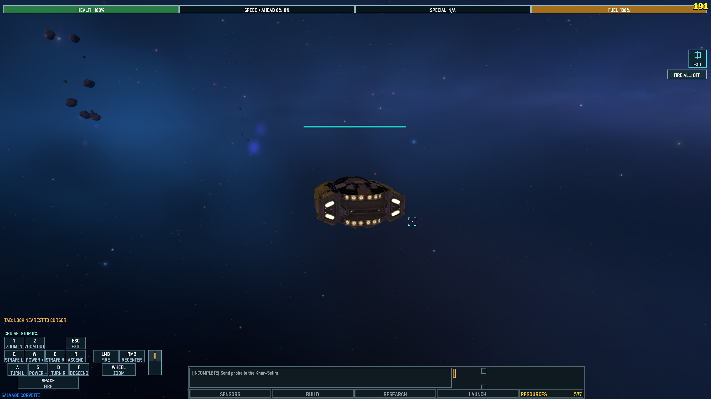
