# OpenHW 1.0.7 - illustrated feature tour

All sixteen user-supplied images, with the duplicate retained. Development screenshots can show 1.0.6; pre-fix and reference views are identified below.

### Portable Fleet Command launcher

**Deploy**

The portable launcher starts normal OpenHW or the full diagnostics executable. The custom border, hangar artwork, bundled fonts and amber/cyan controls carry the game styling into the desktop launcher.

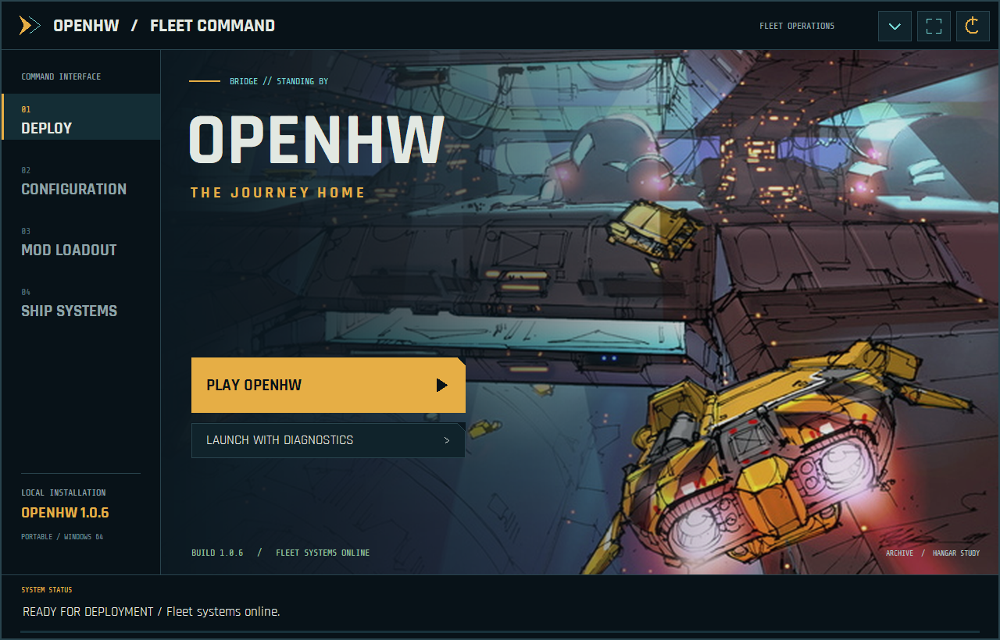

**Mod Loadout**

Enable or disable installed mods and move them up or down in the load order. Later enabled entries take priority; newly discovered mods start disabled. Save the loadout and restart the game to apply changes.

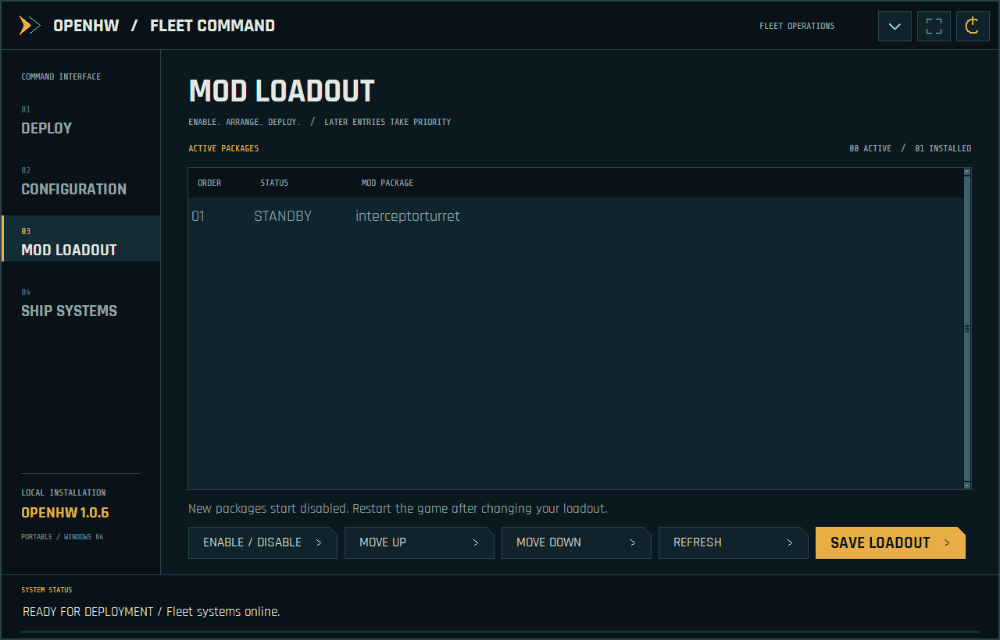

**Configuration**

Browse or search display, graphics, classic effects, audio, keyboard/mouse, player/language, skirmish and gameplay settings. Save them before launching. Shift+F11 authoring documents remain in the in-game editors.

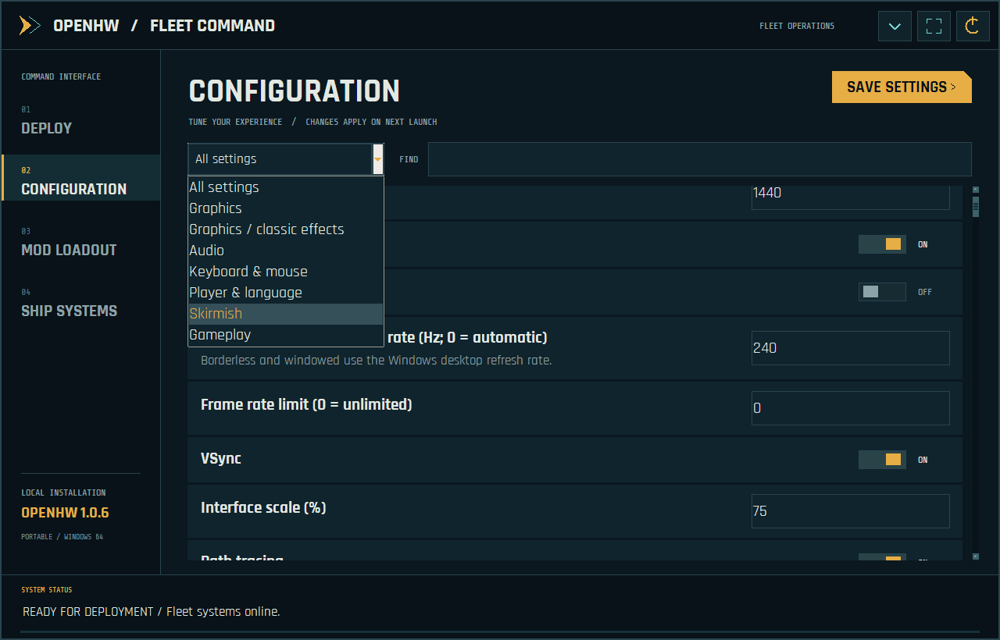

**Ship Systems**

Check for official updates, back up and rebuild the local shader cache, or import a matching voice bank from an owned localized Classic installation. Downloads, runtime files and backups stay in the OpenHW folder.

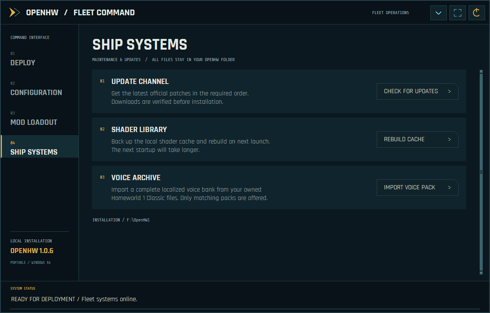

### Menus and live fleet preview

**Main menu**

The fleet command menu groups Story, Training, Multiplayer, Settings, Archive and Modding on the navy overlay while leaving the background artwork visible.

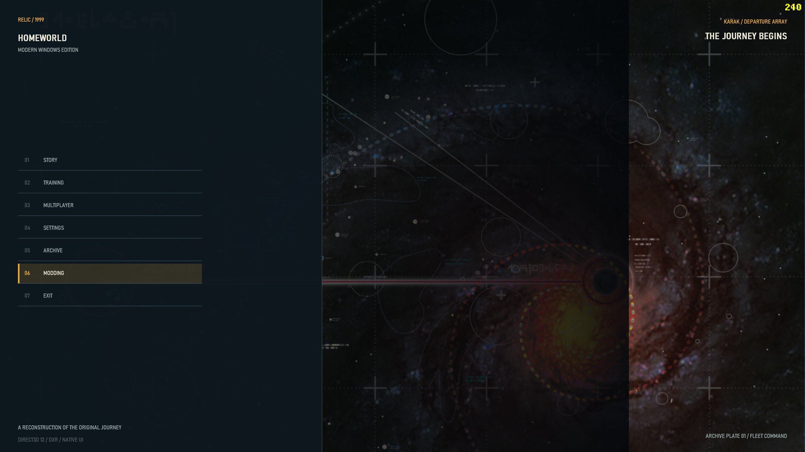

**Story setup and live interceptor**

Centered Story setup combines race selection, saves, Player Setup and a real 3D interceptor. Orbit and zoom the preview; simulate maximum speed to inspect its engine trails. This supplied screenshot predates the 1.0.7 axis correction: the released menu viewer presents the ship horizontally. Gameplay model orientation is unchanged.

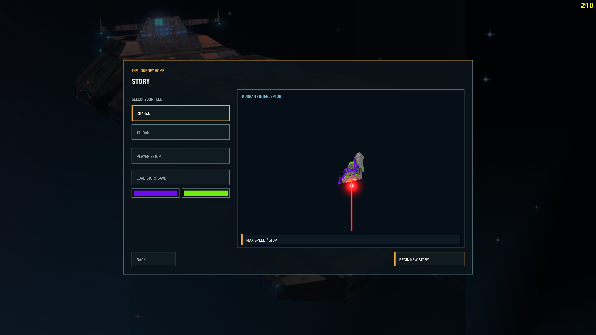

**Multiplayer navigation**

Compact skirmish, saved battle, LAN, online-services and replay actions sit inside the left overlay. Existing connection modes retain their individual availability; this menu redesign does not imply a new online backend or verified multi-computer synchronization.

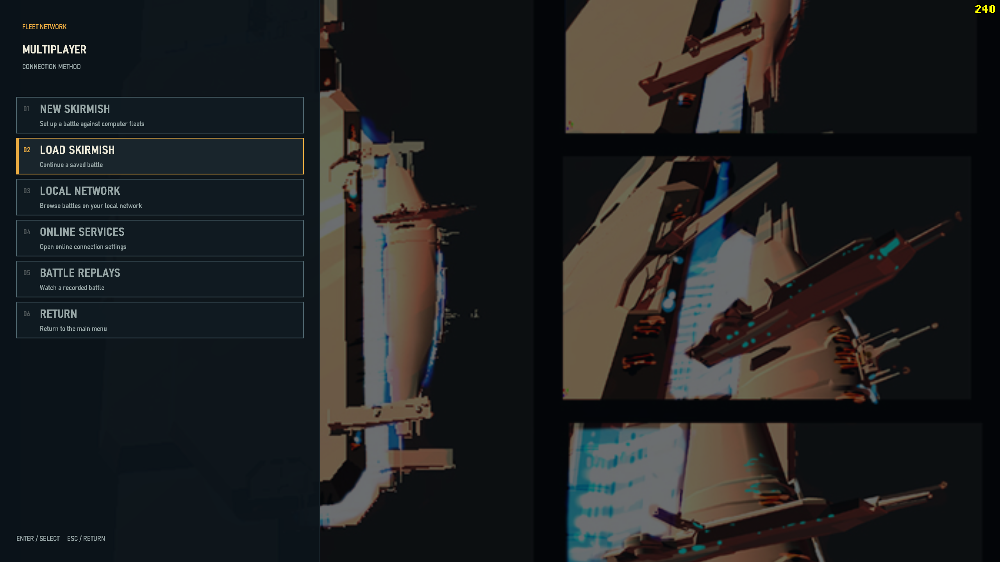

**Fleet Workshop**

The right-hand panel opens Parade Formations, the Ship Editor and Mod Manager without covering the engineering artwork. Use the workshop to arrange fleets, fit subsystems and manage custom content.

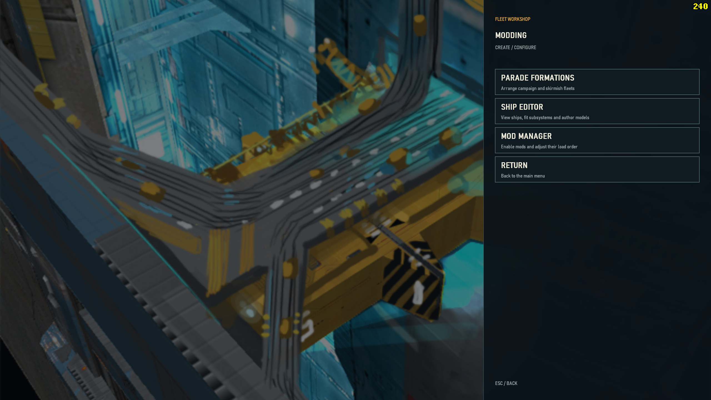

### Authoring tools

**Military Parade editor**

Arrange campaign or multiplayer parade offsets, move/rotate entries, frame the fleet and save separate race/mode presets. This development reference has white model silhouettes; it illustrates the placement interface, not final textured-model appearance.

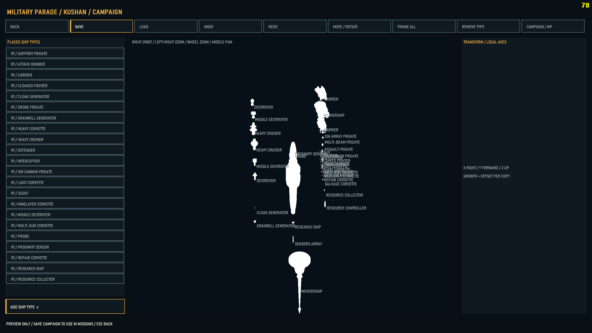

**Parade editor: supplied duplicate**

This is the second supplied copy of the same parade view, retained as requested. The placed-type list and campaign/MP selector control which formation preset is edited. It is not evidence of a separate feature or a corrected texture-rendering issue.

**Ship Editor and subsystem authoring**

Inspect the hull/joint tree, transforms, attachment points and material slots. Copy, paste and place subsystem/turret chains, import geometry and save or append a mod. Source HODs remain read-only. This supplied white-model reference demonstrates the editor layout; this release does not claim to fix those editor silhouettes.

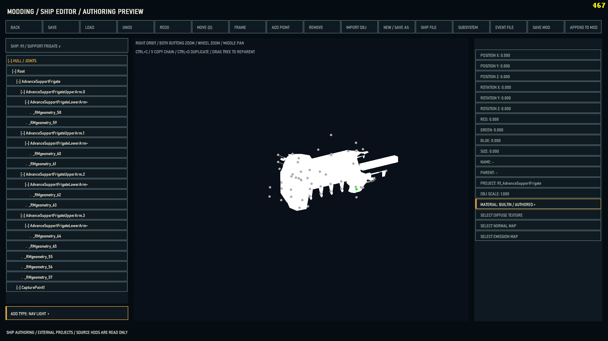

### Campaign, individual colours and ship control

**Fleet command and mission presentation**

Original Homeworld 1 mission scripting and the fleet HUD run with locally imported Remastered ships and authored environments. This view also shows the mission message area and classic-style top-right FPS counter.

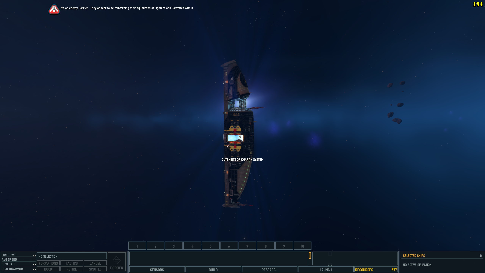

**Remastered ships with original gameplay**

The salvage corvette illustrates the project goal: higher-fidelity imported models while retaining original Homeworld gameplay. The mission HUD, selection information and production shortcuts remain accessible.

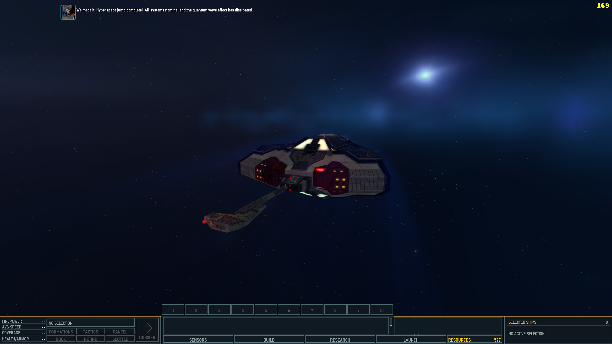

**Single-ship colours**

Select one owned ship and open COLORS beside PILOT. Override hull/base, stripes, engine trails/bulbs, navigation lights, resource beam and hyperspace independently. Unchecked channels inherit fleet appearance; Reset All clears overrides. This screenshot predates the input correction: 1.0.7 fixes the controls, Apply, Reset, Cancel and nested picker routing. Paint is saved for that individual ship; it is a local visual customization, not a new synchronized multiplayer command.

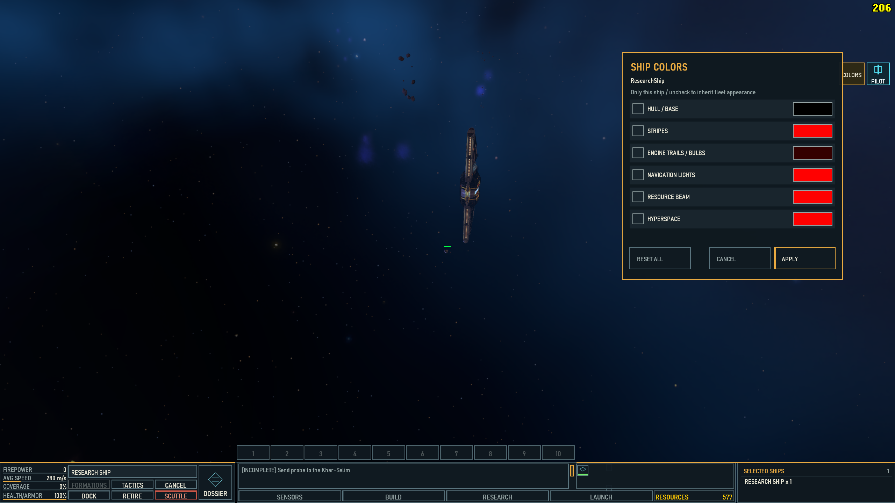

**EVE-style Command control**

Lock targets, approach, orbit, keep range, adjust the speed limit and control weapon banks from one eligible ship. The illustrated command mode is retained alongside direct piloting. Eligible X/Claw formations can also be led through their wingleader.

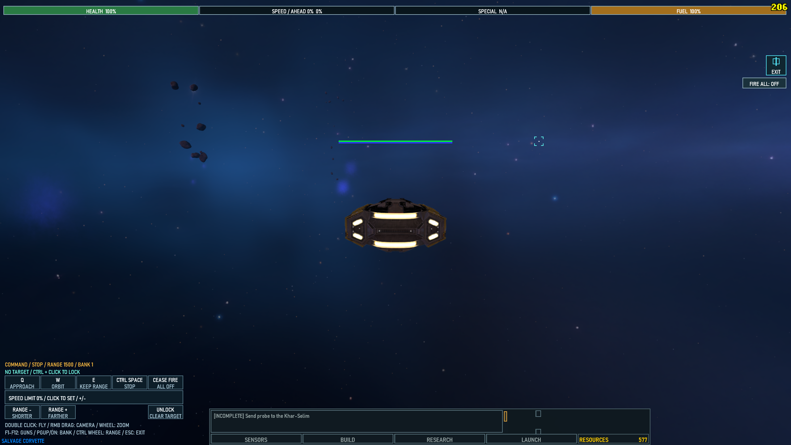

**Direct piloting**

Take direct control of throttle, turning, strafing, vertical movement and weapons. On-screen hints show the available controls; Escape returns to fleet command. Command and Pilot modes are separate choices, with eligibility depending on ship class.

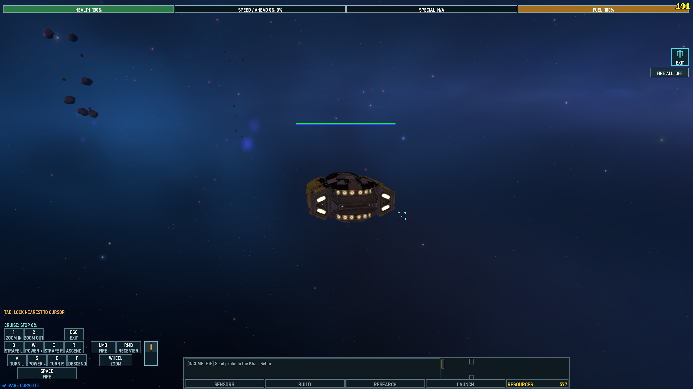
